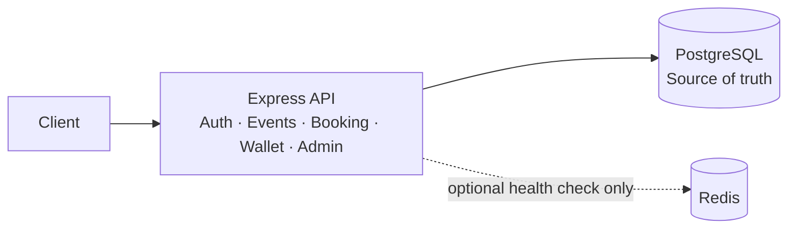

# APEXMATCH

Ticket-booking backend built with Node.js, Express, and PostgreSQL.



## Features

- JWT authentication and role-protected admin APIs
- Atomic seat booking and wallet debit using PostgreSQL transactions and row locks
- Request auditing, booking metrics, and a 100-request concurrency test
- Optional Redis health check; Redis idempotency and RabbitMQ are not implemented

## Run locally

Requires Node.js and PostgreSQL.

```powershell
cd "APEXMATCH Backend\apps\ticket-booking"
npm install
Copy-Item .env.example .env
```

Set `JWT_SECRET` (at least 32 bytes) and your PostgreSQL settings in `.env`, then run:

```powershell
npm start
```

API: `http://localhost:3000` · Tests: `npm test`
